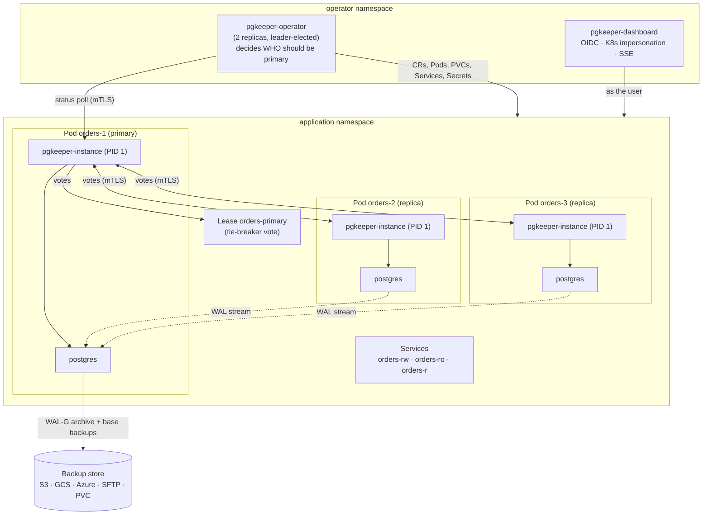

# pgkeeper

A Kubernetes operator for highly available PostgreSQL on **unmodified official `postgres` images**. You declare clusters, roles, databases, grants and backups as CRDs. pgkeeper runs streaming replication, fails over safely, takes WAL-G backups with point-in-time recovery, and ships a dashboard with live access logs.

> **Status: design phase.** This repository currently contains the specifications and architecture decisions. Implementation starts with Phase 0 (toolchain, Makefile, local clusters); see [`docs/specs/09-phases.md`](docs/specs/09-phases.md). Nothing here is usable yet.

## Why another Postgres operator?

[CloudNativePG](https://cloudnative-pg.io), [Zalando's postgres-operator](https://github.com/zalando/postgres-operator) and [Crunchy PGO](https://github.com/CrunchyData/postgres-operator) are mature. pgkeeper exists to close the gaps they leave ([ADR-015](docs/adr/015-build-to-close-existing-gaps.md) keeps a sourced gap ledger):

| Gap | pgkeeper |
|---|---|
| No declarative per-object grants | `PostgresGrant`: table, sequence, function and schema privileges, default privileges; revokes only what it granted |
| No operational console with live Postgres/access logs | Dashboard with OIDC login, all access through Kubernetes impersonation, live log tail |
| An isolated old primary can keep accepting writes after a failover | Quorum lease with derived timers and an immediate self-fence |
| An API-server outage can take primaries down | A healthy primary keeps writing on its peers' votes when the control plane is unreachable |
| Vendor images (Spilo, Crunchy) | Official Debian `postgres:16/17/18` images; tools injected via image volume |
| No SFTP backup target | WAL-G over SSH with enforced host keys |
| Statement literals in logs (personal data) | Optional redaction (DPDP/GDPR) |

pgkeeper also lacks things the others have, such as in-place major upgrades, volume snapshots and cross-cluster replicas. Those are tracked in the same ledger as parity work.

## Architecture



| Component | What it does |
|---|---|
| **Operator** (`pgkeeper-operator`) | Reconciles CRDs into Pods and PVCs (no StatefulSets), Services, Secrets, the Lease, PDBs and RBAC. Decides which instance *should* be primary. Orchestrates switchovers, primary-last rolling updates, backups and restores. The only writer of CR status. |
| **Instance manager** (`pgkeeper-instance`) | Static Go binary, PID 1 in every Postgres container, so if it dies Postgres dies with it. Bootstraps (initdb / clone / restore), renders config, supervises the postmaster, takes part in the primary lease and fences itself, promotes and demotes, runs WAL-G, serves probes, an mTLS API and metrics, and re-emits Postgres logs as categorised JSON. |
| **Dashboard** (`pgkeeper-dashboard`) | Thin operational console: topology, health, backups, switchover and acknowledge-failover actions, live log tail. Every Kubernetes call impersonates the logged-in user, so their RBAC applies. Stores nothing. |
| **Tools image** (`pgkeeper-tools`) | `FROM scratch` with static `pgkeeper-instance` and `wal-g`, mounted into the official image as an image volume (init-container copy on older nodes). |

### Core rules
- **Safety and policy are separate.** The primary lease decides who *may* write. The operator decides who *should* be primary. If the operator is down, failover is delayed, never unsafe.
- **Quorum lease** ([ADR-016](docs/adr/016-quorum-lease.md)):

  | Action | Needs |
  |---|---|
  | Stay primary | the Kubernetes Lease **or** a majority of peer votes |
  | Become primary | the Lease **and** enough peer votes to overlap every possible sustaining group |

  This means:
  - two primaries are impossible;
  - a primary survives an API-server outage;
  - a primary keeps running alone while the API server is reachable.
- **Fence immediately.** A primary that can't prove it holds the lease stops with `pg_ctl stop -m immediate` before anyone else can promote. Clients are disconnected and reconnect through `-rw`.
- **Planned changes lose nothing.** Switchovers, node drains and pod deletions hand over at the exact end-of-WAL LSN ([ADR-021](docs/adr/021-shutdown-handoff.md)).
- **Failover is acknowledged by a human.** Every automatic failover creates a `PostgresPrimaryOverride`. The original preference (pin) applies again only after a person deletes it ([ADR-017](docs/adr/017-primary-override.md)).
- **Crash handling:** restart in place on a single crash, fail over on a crash loop; configurable ([ADR-019](docs/adr/019-crash-handling.md)).
- **PITR always creates a new cluster**, and two clusters can never archive to the same path.

## CRDs (`pgkeeper.in/v1alpha1`)
| Kind | Purpose |
|---|---|
| `PostgresCluster` | Instances, image, storage, replication (async / quorum-sync), HA timings, pinning, backups, TLS, logging, monitoring, notifications |
| `PostgresSwitchover` | One-shot planned switchover (`Graceful` / `Fast`) |
| `PostgresPrimaryOverride` | Created by the operator after a failover; deleted by a human to acknowledge |
| `PostgresRole` / `PostgresDatabase` / `PostgresGrant` | Declarative access control; passwords delivered as SCRAM verifiers |
| `PostgresBackupStore` / `PostgresBackup` / `PostgresScheduledBackup` | WAL archiving, full + delta backups, schedules, retention |
| `PostgresPooler` | Optional PgBouncer (Phase 27) |

## Scope
- PostgreSQL 16, 17, 18 (official Debian images); Kubernetes 1.34–1.37; tested locally on **kind** and **k3d**.
- One operator can manage many namespaces (all, a list, or a label selector). Several installs can coexist with disjoint scopes.
- Observability: Prometheus metrics, shipped alert rules and Grafana dashboards, IM-measured disk pressure that works on any storage, and an optional failover webhook (Slack or generic JSON).
- Not in v1: major-version upgrades, volume-snapshot backups, cross-cluster replicas, FTP (use SFTP), Alpine images, in-place PITR.

## Documentation
| | |
|---|---|
| [`docs/specs/00-overview.md`](docs/specs/00-overview.md) | Requirements, challenged requirements, architecture |
| [`docs/specs/01-api.md`](docs/specs/01-api.md) | Every CRD, field, validation rule and status |
| [`docs/specs/02-instance-manager.md`](docs/specs/02-instance-manager.md) | PID 1 behaviour, bootstrap, config, probes, API, logs |
| [`docs/specs/03-ha.md`](docs/specs/03-ha.md) | **Safety invariants**, quorum lease, failover, switchover, pinning, rolling updates |
| [`docs/specs/04-backup-restore.md`](docs/specs/04-backup-restore.md) | Stores, archiving, full/delta backups, retention, PITR |
| [`docs/specs/05-access-control.md`](docs/specs/05-access-control.md) | Roles, databases, grants, HBA, TLS, RBAC |
| [`docs/specs/06-observability-dashboard.md`](docs/specs/06-observability-dashboard.md) | Metrics, alerts, notifications, logs, dashboard |
| [`docs/specs/07-reconciliation-and-tenancy.md`](docs/specs/07-reconciliation-and-tenancy.md) | Controller rules, drift, multi-namespace, operator HA |
| [`docs/specs/08-testing-and-makefile.md`](docs/specs/08-testing-and-makefile.md) | Test pyramid, chaos/ledger tests, Makefile contract |
| [`docs/specs/09-phases.md`](docs/specs/09-phases.md) | The phases from Phase 0 to Phase 28, each with acceptance criteria |
| [`docs/specs/10-glossary.md`](docs/specs/10-glossary.md) | Every term, with intuition and examples |
| [`docs/specs/11-ha-scenarios.md`](docs/specs/11-ha-scenarios.md) | What happens in each failure and maintenance scenario, with diagrams |
| [`docs/adr/`](docs/adr/README.md) | Architecture decision records |

The specs are the source of truth. Code that deviates updates the spec in the same change.

## Development (once Phase 0 lands)
Prerequisites: `docker`, `go`, `make`, `git`. Everything else is installed into `./bin` by the Makefile.
```sh
make dev                          # kind cluster + test infra + operator + sample clusters
make CLUSTER_PROVIDER=k3d dev     # same on k3s
make verify lint test             # before every commit
make accept-pN                    # acceptance suite for phase N
```
Each phase is done only when `make accept-pN` passes on kind **and** k3d. Contributor and agent conventions are in [`CLAUDE.md`](CLAUDE.md).
