# 11 — HA Scenarios: What Happens When…

Explanatory companion to **03-ha.md** and **ADR-016…021**. Those are normative; if this document disagrees with them, they win, and this document is the one to fix. Each scenario lists the setup, the step-by-step behaviour with timings, what clients see, the data-loss bound, and the test that proves it (`F#` = row in ADR-016's fault table).

Unless stated otherwise:
- Mode `spec.ha.quorum.mode: Peers` (the target design). Differences in `KubernetesLease` mode (the default until Phase 28) are called out.
- Default timings: `lease.duration` 15 s, `renewDeadline` 10 s, `retryPeriod` 2 s, `fenceTimeout` 3 s, `failoverDelay` 0, `voterRemovalDelay` 30 s, `maxFailoverLag` 64 MiB.
- Asynchronous replication (`synchronous.mode: Off`) unless stated.
- `t = 0` is the **send time of the primary's last renewal that still formed a sustain quorum**.

---

## 0. Background in one page

### 0.1 Who decides what
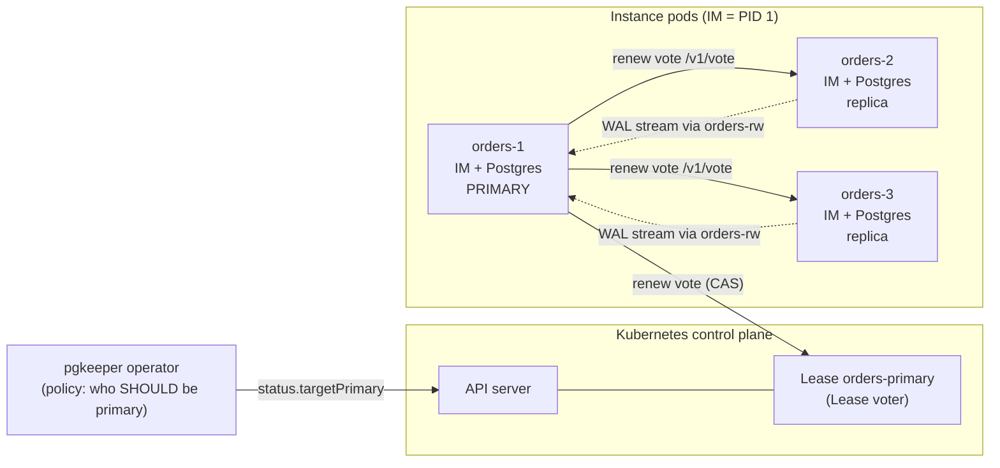
- **Safety** (at most one writable primary) comes from the quorum lease alone. Each instance manager enforces it locally.
- **Policy** (which instance should be primary) comes from the operator via `status.targetPrimary`. If the operator is down, failover is delayed, never unsafe.

### 0.2 The two quorums
| Action | Needs valid grants from |
|---|---|
| **Sustain** (keep writing) | the Lease **or** ≥ `Qs` instance voters |
| **Acquire** (promote) | the Lease **and** ≥ `Qa` instance voters |

`Qs = ⌊n/2⌋+1`, `Qa = n − Qs + 1`, and the holder's own vote counts. Every acquire quorum overlaps every sustain quorum, so two primaries are impossible.

| n | Qs / Qa | Primary keeps writing when… | Failover possible when… |
|---|---|---|---|
| 1 | Lease only | API server reachable | — |
| 2 | 2 / 1 | API reachable, **or** the replica is reachable | API + the candidate |
| 3 | 2 / 2 | API reachable, **or** ≥ 1 replica reachable | API + candidate + 1 |
| 5 | 3 / 3 | API reachable, **or** ≥ 2 replicas reachable | API + candidate + 2 |

### 0.3 The fencing clock
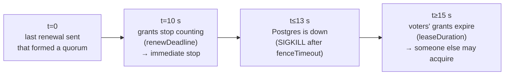
The 2 s safety margin (15 − 10 − 3) is enforced by CEL. A new primary can't exist before the old one is down.

### 0.4 Scenario matrix
| § | Scenario | Writes during the event | Automatic failover | Acked-write loss (async) | Acked-write loss (`Required`) | Typical write outage |
|---|---|---|---|---|---|---|
| 1 | Planned switchover (Graceful) | paused | n/a (planned) | 0 | 0 | 1–5 s |
| 2 | Rolling update | paused once | n/a | 0 | 0 | 1–5 s |
| 3 | Node drain / primary pod deleted | paused once | n/a (switchover or handoff) | 0 | 0 | 1–5 s |
| 4 | Postmaster crash | errors during restart | only on crash loop / start timeout (configurable) | 0 (restart) / ≤ lag (escalation) | 0 | seconds; ≤ 30 s after escalation |
| 5 | Primary pod / node dies | none | yes | ≤ replication lag | 0 | ≤ 30 s |
| 6 | Primary fully isolated | errors after fence | yes | ≤ ~13 s of writes | 0 | ≤ 30 s |
| 7 | Primary cut off from API server only | continue | no (not needed) | 0 | 0 | 0 |
| 8 | Whole API server outage | continue (n ≥ 2) | impossible | 0 | 0 | 0 (n ≥ 2), until API returns (n = 1) |
| 9 | Replicas die (minimum availability) | continue | n/a | 0 | writes block | 0 |
| 10 | 2 instances split from each other | continue on primary | no | 0 | writes block | 0 |
| 11 | Sequential failures | continue / fail over | yes, to last survivor | ≤ lag | 0 | ≤ 30 s per failover |
| 12 | Simultaneous failures | none | no — human | ≤ lag | 0 | until human acts |
| 13 | Operator down / killed mid-failover | continue | delayed | unchanged | unchanged | + operator restart time |
| 14 | Process / VM freeze | stale writes possible | yes | stale writes possible | 0 | ≤ 30 s |
| 15 | No eligible candidate (lag) | none | waits | — | — | until replica catches up or human forces |
| 16 | Synchronous `Required`, quorum of standbys missing | blocked | waits | — | 0 | until standbys return |
| 17 | Pinning and primary override | per policy | per policy (switchback only after a human deletes the override) | as §5 | as §5 | as §5; switchback 1–5 s when acknowledged |
| 18 | Former primary rejoins | — | — | — | — | — |
| 19 | Node lost with local storage | — | — | — | — | — |
| 20 | Voter restarts mid-lease | continue | no | 0 | 0 | 0 |
| 21 | API server down **and** primary dies | none | impossible until API returns | ≤ lag | 0 | until API returns |
| 22 | Disk filling up (data or WAL) | continue until full, then stop | only via crash loop | ≤ lag | 0 | from "full" until failover or space freed |

---

## 1. Planned switchover (`PostgresSwitchover`, Graceful)

**Setup:** n = 3; `orders-1` primary; user creates a switchover to `orders-2`.

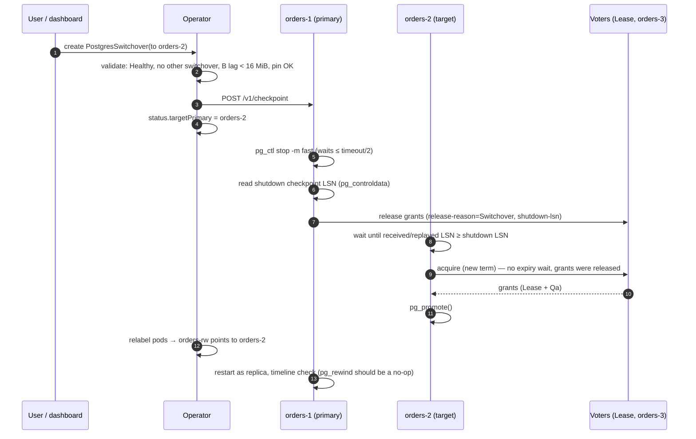
- **Clients:** writes fail or queue from step 5 until `-rw` follows the new primary, typically 1–5 s. With a pooler (`pauseOnSwitchover`, Phase 27), queries queue instead of failing.
- **Data loss:** none. The target waits for the shutdown LSN.
- **Abort path:** if B doesn't reach the shutdown LSN within the timeout, the switchover fails, the operator resets `targetPrimary`, and A restarts and re-acquires.
- **Fast mode:** skips the drain and `CHECKPOINT` and waits at most `min(10 s, timeout/2)` for the fast stop, so zero loss and no rewind still hold. Only if the fast stop doesn't finish in time does the IM escalate to immediate; the switchover then completes as a failover to the target with `lossy: true` and the old primary goes through the rewind check (03 §7 step 3).
- **Proof:** Phase 9 — 10 switchovers under ledger load, 0 lost acked writes, p95 ≤ 5 s.

## 2. Rolling update (image digest, resources, restart-requiring parameters)

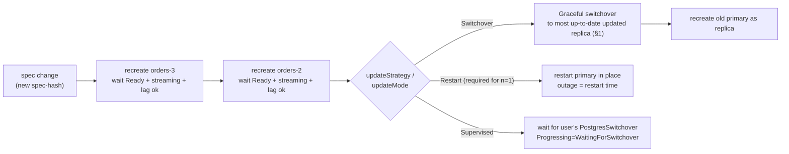
- Replicas go one at a time, highest serial first. The primary always goes last.
- **Clients:** one switchover-sized pause (1–5 s), or the restart time for `Restart`.
- **Proof:** Phase 13 — minor image bump under load, one switchover, ≤ 5 s, 0 lost writes.

## 3. Node drain of the primary's node, or primary pod deleted

**Drain** (`kubectl drain`): the drain cordons the node first; the primary PDB (minAvailable 1, selector `role=primary`) refuses the primary's eviction, so the operator reacts to the **node** instead (03 §9 step 5).

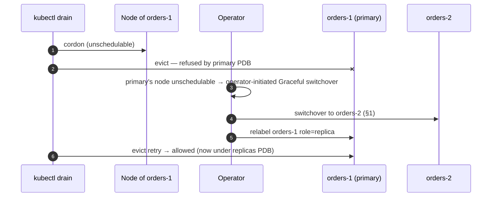
- **Clients:** one switchover pause (1–5 s), zero loss. No override is created (operator-initiated, ADR-017).

**Primary pod deleted or SIGTERM'd otherwise** (manual `kubectl delete pod`, node shutdown, eviction not pre-empted): **shutdown handoff** (03 §7.1, ADR-021). The IM fast-stops, records the shutdown LSN and releases with it; the operator promotes a replica that has received up to that LSN within `min(10 s, lease.duration)`. Result: zero lost commits, no rewind. If no replica gets there in time, a normal failover follows (§5).

- **Proof:** Phase 13 (drain → switchover precedes eviction), Phase 9 (delete primary pod under ledger load → 0 lost acked writes).

## 4. Postmaster crash on the primary (ADR-019)

**Setup:** n = 3; default `spec.ha.crashHandling` (`RestartInPlace`, 5 crashes in 5 min, backoff 1 s → 30 s, `startTimeout` 2 min).

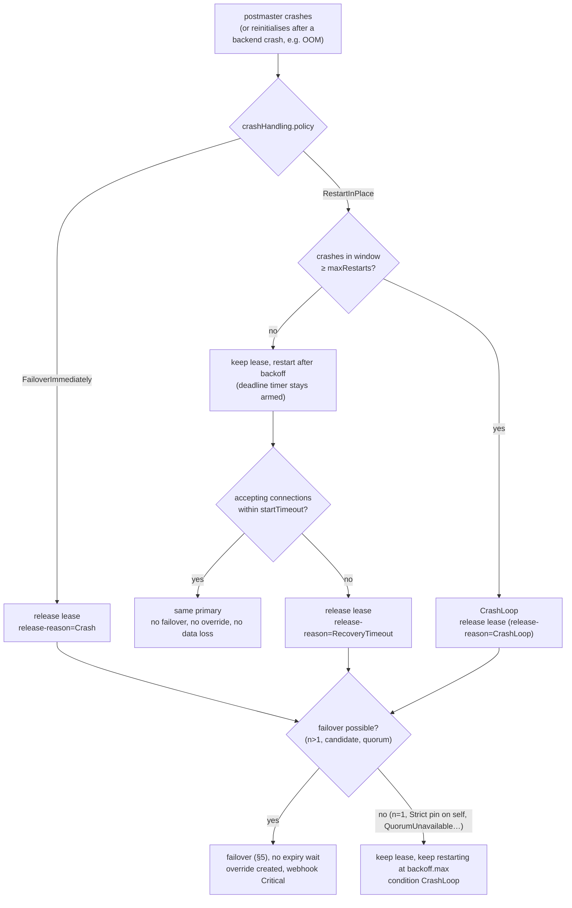
- **Clients:** a single crash means errors during crash recovery (typically seconds), then the same primary. On escalation: as §5 (≤ 30 s after release).
- **Data loss:** restart in place: none, since all committed WAL is on the primary's disk. Escalation: as §5.
- **Safety:** Postgres down accepts no writes. It is restarted as primary only while a sustain quorum is valid, and a lease loss during recovery fences as usual (03 §3.7).
- **Replicas:** always restart in place. A replica in `CrashLoop` is excluded from failover candidates.
- **Proof:** Phase 10 crash-handling acceptance.

## 5. Primary pod or node dies (unplanned failover)

**Setup:** n = 3; `orders-1` primary dies at t ≈ 0 (pod killed, node stopped).

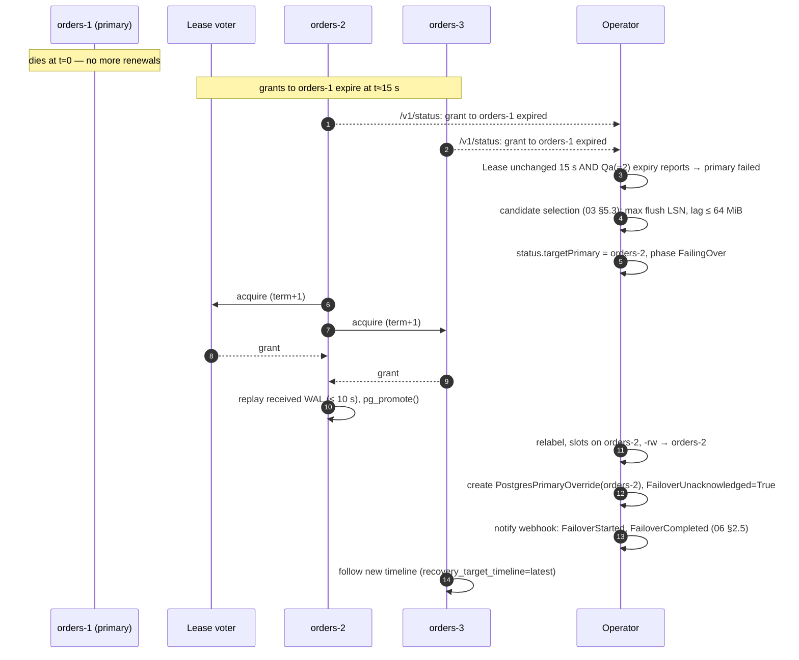
- **Timeline:** detection at ~15–17 s, promotion shortly after (replay wait ≤ 10 s), then endpoint propagation. **Target ≤ 30 s.**
- **Data loss:** async: whatever had not reached the new primary when A died, bounded by the eligibility rule (lag ≤ `maxFailoverLag`). `Required`: none (§16).
- **Old primary:** stays down. If it comes back, it rejoins via §18 as a **replica** and stays one until a human deletes the override (§17).
- **Damping:** if the last failover was < 5 min ago, the operator waits `2 × failoverDelay` (min 30 s) before electing (event `FailoverDamped`).
- **Proof:** F6 (n = 3), F5 (n = 2), Phase 10 e2e-chaos.

## 6. Primary fully isolated (network partition from everything)

**Setup:** n = 3; at t ≈ 0 the primary's node loses all network: no API server, no peers. Clients on the same side of the partition (if any) can still reach it.

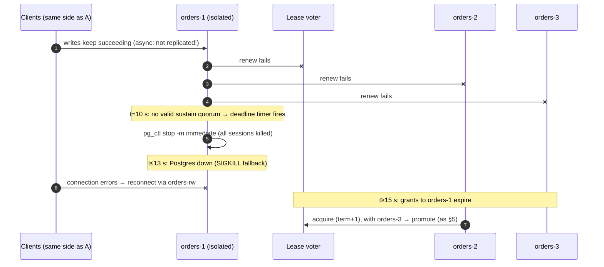
- **No split-brain:** A is down by t ≤ 13 s, and B can't acquire before t ≥ 15 s.
- **Data loss (async):** writes A acknowledged after it lost contact with the replicas were never streamed. That is up to ~13 s of writes, discarded when A rejoins via rewind (§18). With `Required` they block instead of being acknowledged, so none are lost.
- **Proof:** F7; Phase 8 acceptance (primary stops ≤ 13 s; ledger writer sees errors, not silent success).

## 7. Primary cut off from the API server only

**Setup:** n = 3. The primary's node can't reach the API server (e.g. a broken route), but the instances still reach each other.

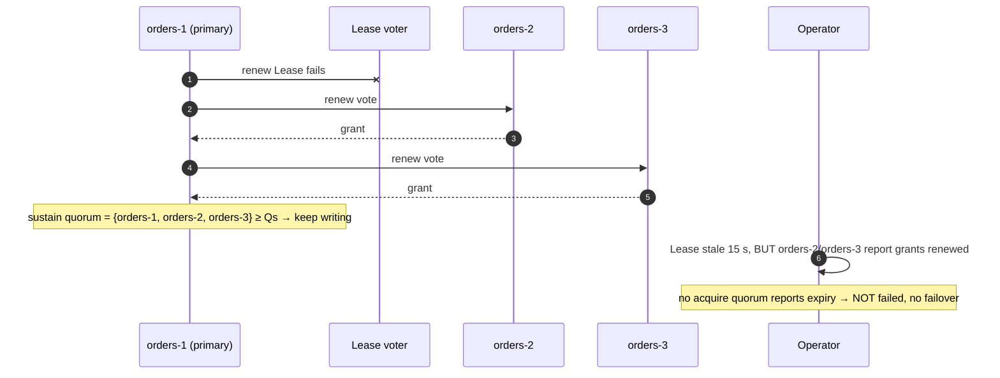
- **Clients:** unaffected.
- **While it lasts:** A can't see CR/ConfigMap updates (stale cache) and the operator can't relabel A's pod. Config changes wait.
- **`KubernetesLease` mode:** A fences at t ≤ 13 s, the operator fails over (§5), and clients see ≤ 30 s of outage. This is the ADR-015 C1 regression that `Peers` mode fixes.
- **Proof:** F2.

## 8. Whole API-server outage (control plane down, e.g. k3d server restart)

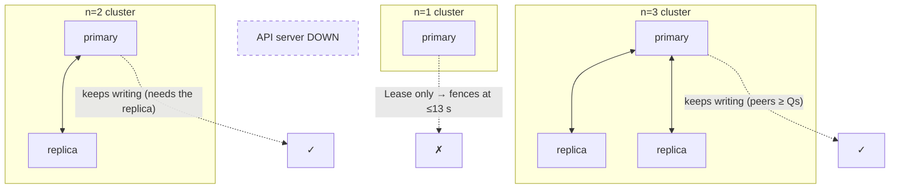
- **n ≥ 2 in `Peers` mode:** no fence, writes continue (F1). Nothing can fail over during the outage (§21).
- **n = 1:** the instance path is disabled (03 §3), so the primary fences. A single instance can't prove it is the only one, e.g. if a re-attached RWO volume started a second pod.
- **n = 2 with the replica also down:** fences (F10 equivalent). That's a double fault.
- **`KubernetesLease` mode:** every primary fences.
- **During the outage:** no Services change, no CR edits, no failovers, no scaling. On recovery, the operator resyncs and nothing restarts.
- **Proof:** F1; Phase 10b on k3d (single-server restart causes no fence).

## 9. Replicas die — minimum availability

**Setup:** n = 3; both replicas die; the API server is fine.

```mermaid
sequenceDiagram
    autonumber
    participant A as orders-1 (primary)
    participant L as Lease voter
    participant B as orders-2 (dead)
    participant C as orders-3 (dead)
    participant OP as Operator
    A->>L: renew
    L-->>A: grant
    A-xB: renew fails
    A-xC: renew fails
    Note over A: sustain via Lease alone → keep writing
    OP->>OP: after voterRemovalDelay (30 s): remove orders-2, orders-3 (joint quorum, holder acks)
    Note over A,OP: n=1 → Lease-only; operator recreates/re-clones replicas when possible
```
- **Clients:** unaffected (async).
- **Durability:** while no replica runs, a primary failure means no failover and possibly a restore from backup. `Required`: writes **block** (the sync list never shrinks). `Preferred`: the list shrinks and `SynchronousDegraded` is set.
- **New replicas:** clone from the primary and are added back to the voter set (joint quorum).
- **Proof:** F4 (n = 3), F3 (n = 2), F7.

## 10. Two instances split from each other (n = 2)

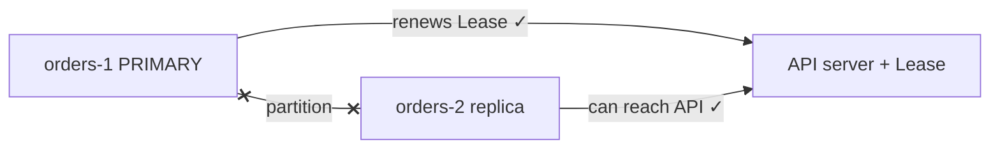
- A sustains on the Lease. B needs the Lease to acquire (Qa = 1, but the Lease is always required), and A holds it, so B can't promote.
- The operator sees the Lease being renewed, so no failover.
- **Clients:** unaffected. B's lag grows. If it exceeds `max_slot_wal_keep_size`, B needs a re-clone (`NeedsReclone`).
- **Proof:** F8.

## 11. Sequential failures — down to the last survivor

**Setup:** n = 3. orders-2 dies; 2 minutes later orders-1 (primary) dies.

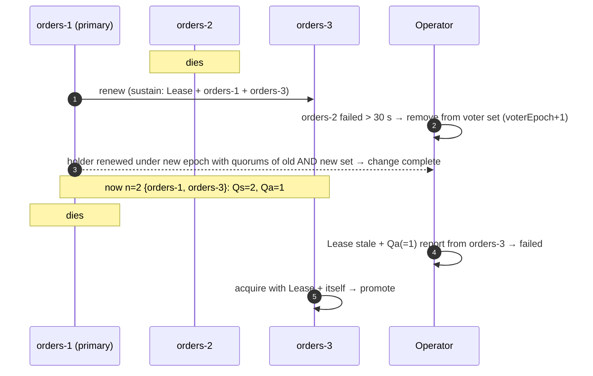
- Each failure that's noticed before the next one shrinks the voter set, so failover keeps working until one instance is left.
- After that, the cluster is Lease-only (n = 1). Losing the last instance means restoring from backup.
- **Proof:** F12, F15.

## 12. Simultaneous failures (before the voter set can shrink)

**Setup:** n = 3. orders-1 (primary) and orders-2 die at the same moment, e.g. a zone outage.
- orders-3 needs the Lease plus `Qa = 2` instance votes. Only its own vote is available, so it can't promote.
- The operator sets `PrimaryAvailable=False reason=QuorumUnavailable`. The cluster stays read-only (orders-3 keeps serving `-ro`).
- **Why it waits:** from orders-3's view, "orders-1 and orders-2 are dead" looks identical to "they're cut off from me and the API server and still serving writes together" (they would be sustaining on each other).
- **Human path:** confirm they're really down (e.g. the nodes are gone in the cloud console), then create a `PostgresSwitchover` with `mode: Fast` and `pgkeeper.in/force-promote: orders-3`. The operator removes the dead voters without acknowledgement, and orders-3 promotes with Lease + itself.
- **Data loss:** ≤ lag of orders-3 (async). With `Required` and `ANY 1`, orders-3 may lack commits only orders-2 had acknowledged; the forced promotion makes that explicit.
- **Proof:** F13.

## 13. Operator down, or killed mid-failover

- **Primaries:** unaffected. They renew with voters directly; the operator isn't a voter.
- **Failover:** delayed until a leader operator replica is back (leader election ≤ 15 s, plus any restart). Failover is never unsafe, because the lease rules don't depend on the operator.
- **Mid-failover kill:** `targetPrimary` and `phase: FailingOver` are persisted in status. The new leader resumes: the candidate either already holds an acquire quorum and promotes, or keeps trying.
- **Proof:** Phase 10 e2e-chaos ("kill operator during failover"); Phase 26 (kill leader, reconcile resumes ≤ 20 s).

## 14. Process or VM freeze (SIGSTOP, VM pause, stop-the-world)

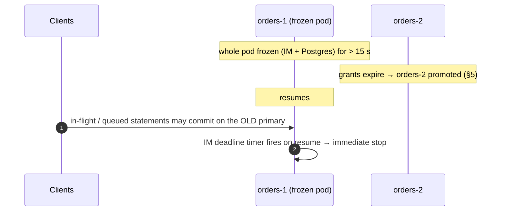
- The lease can't stop a frozen process from finishing work in the moment between resuming and the IM noticing. This is the documented limit (03 §3.6).
- **Only complete fix:** `synchronous.dataDurability: Required`. The old primary's commits wait for standby acknowledgements that never come, because the standbys now follow the new primary.
- **Freeze of the postmaster only (IM still running):** the IM sees Postgres unhealthy, then fences; SIGKILL works on stopped processes.
- **Proof:** F16; Phase 11 (`Required` → 0 lost acked writes, 0 stolen ids under SIGSTOP).

## 15. No eligible candidate (all replicas too far behind)

- Candidates whose lag vs the last known primary LSN exceeds `maxFailoverLag` (64 MiB) are excluded (03 §5.3).
- If all are excluded: no failover, condition `NoEligibleCandidate`. The operator waits for a replica to catch up (if the primary is gone, it can only catch up from the WAL archive), or for a human to force it.
- **Force:** `PostgresSwitchover mode: Fast` + `pgkeeper.in/force-promote: <instance>`, accepting the loss of everything beyond that replica's LSN.

## 16. Synchronous replication `Required`

**Setup:** n = 3, `mode: Quorum`, `number: 1` → `synchronous_standby_names = 'ANY 1 (orders-2, orders-3)'`.
- **Normal:** each commit waits for 1 of the 2 standbys. No acknowledged write exists on the primary alone.
- **Failover:** the operator picks the highest flush LSN, but only if at least `n−1 − k + 1 = 2` replicas reported. Otherwise the replica holding the acknowledged write might be the unreachable one, so it waits with `QuorumUnavailable` (03 §5.3 step 4). Data loss is 0.
- **Both standbys down:** writes block (durability over availability). `Preferred` would instead shrink the list and set `SynchronousDegraded`.
- **Scope of the guarantee (I3):** commits made with `synchronous_commit = on` or `remote_apply`. Sessions, roles or databases that lower it to `local`/`off` are not covered; the IM reports role/database overrides as condition `SynchronousCommitOverridden` (03 §6).

## 17. Pinning and the primary override (ADR-017)

Who should be primary: **`PostgresPrimaryOverride` > `spec.primary.pin` > best candidate**. The operator creates/updates the override after every automatic failover and every human-requested switchover. Only a human deletes it.

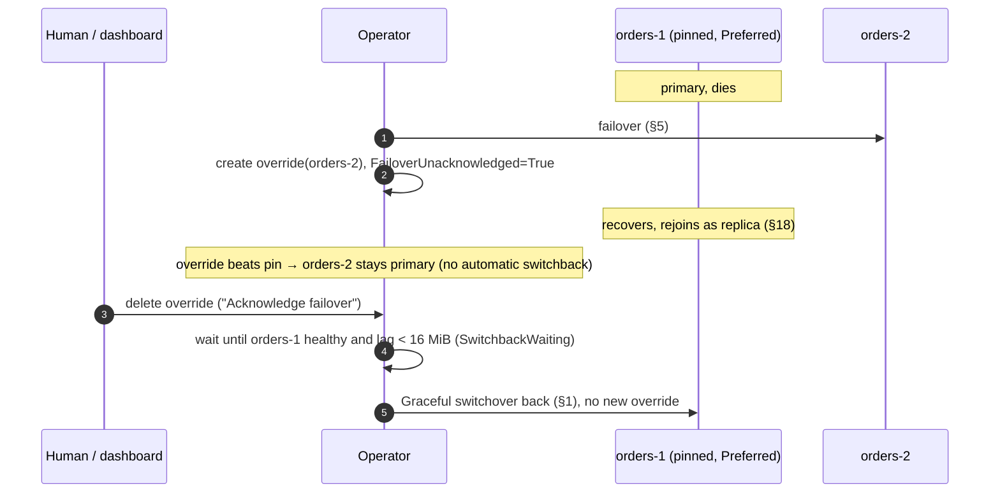

| Policy | Primary fails | Failed instance recovers | Human deletes the override |
|---|---|---|---|
| unset | failover (§5); override created | stays a replica | nothing moves; condition cleared |
| `Preferred` | failover elsewhere; override created | stays a replica | Graceful switchover back to the pinned instance |
| `Strict` | **no failover**; read-only; `StrictPinWaiting`; no override | becomes primary again | — (never created) |

- Human switchover to a non-pinned target: `Rejected` under Strict. Allowed under Preferred, and it creates/updates the override, so the pin does not pull it back.
- Operator-initiated switchovers (rolling update, eviction) update an existing override but never create one.
- Override older than 24 h → alert `FailoverUnacknowledged` (info).
- In `Peers` mode, `Strict` still needs the pinned instance to obtain an acquire quorum.

## 18. Former primary rejoins

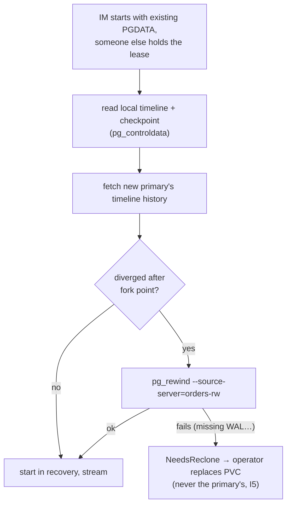
- After §1 (switchover): no divergence, so the rewind is a no-op.
- After §5/§6: divergence is likely (async writes after the fork are discarded).
- pg_rewind connects as the dedicated `pgkeeper_rewind` role (cert auth, read-only file-access grants; 05 §1.4, §4). If the old primary crashed or was fenced, pg_rewind first runs crash recovery on it.

## 19. Node lost with node-local storage (kind/k3d local-path, bare metal)

- Pods with local PVs can't move. After `nodeLossTimeout` (10 min):
  - **replica:** delete PVC + pod, recreate on another node, re-clone. In `Peers` mode, its voter was already removed after `voterRemovalDelay`, and the new instance is added back.
  - **former primary:** failover already happened (§5); then treated like a replica.
  - **only instance:** never auto-deleted (I5). `InstanceStranded` is raised.

## 20. A voter restarts mid-lease

- An instance voter persists (candidate, term, voterEpoch) before answering.
- After a restart it treats that grant as freshly given and refuses other candidates for a full `leaseDuration`. The holder simply continues renewing.
- **Proof:** F14.

## 21. API server down **and** the primary dies

- Survivors can't acquire, because every acquire quorum needs the Lease. The operator can't set `targetPrimary`, and `-rw` can't be re-pointed anyway.
- Writes are unavailable until the API server returns. Then it's §5 as normal.
- This is the deliberate trade-off for never fencing a healthy primary during a control-plane outage (§7, §8).
- **Proof:** F11.

## 22. Disk filling up (data or WAL volume)

The most common cause is a stuck WAL archive: segments can't be uploaded, so `pg_wal` keeps growing (04 §4). Other causes are data growth or a replication slot holding WAL for a dead replica (capped by `maxSlotWALKeepSize`).

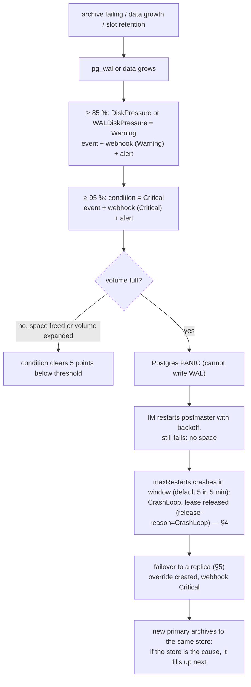
- **Where it's measured:** the IM measures `statfs` itself every 15 s, so this works on local-path/hostPath volumes, where kubelet volume stats are missing (ADR-018).
- **Clients:** unaffected until the volume is full; then errors until failover (≤ 30 s after the crash loop is declared) or until space is freed.
- **Data loss:** async: ≤ replication lag at the PANIC. With `Required`: 0.
- **What to do at Warning:** fix the archive (`ContinuousArchiving=False` points at it), or increase `storage.size` / `walStorage.size` (allowed when the StorageClass supports expansion). Failover doesn't fix a store outage: the new primary inherits it.
- **Not in v1:** automatic PVC growth (ADR-018, possible later phase).
- **Proof:** Phase 5 (condition on fill/free), Phase 18 (wrong store credentials → WAL accumulates → `ContinuousArchiving=False`), Phase 23 (alerts and webhook).

---

## Appendix A — Mode comparison
| Scenario | `KubernetesLease` | `Peers` |
|---|---|---|
| §7 Primary cut off from API only | fence + failover, ≤ 30 s outage | no impact |
| §8 API server outage | every primary fences | n ≥ 2: no impact |
| §9 All replicas dead, API fine | keep writing | keep writing |
| §10 2-instance split | keep writing | keep writing |
| §12 Simultaneous loss of primary + replica (n=3) | automatic failover to the survivor | human-confirmed forced promotion |
| Extra moving parts | none | peer mTLS, `/v1/vote`, voter-set changes |

## Appendix B — Previously open issues (all resolved)
| Where | Issue | Resolution |
|---|---|---|
| §1 | Fast switchover couldn't guarantee zero loss | Fast uses a fast stop too; immediate only as a flagged escalation (03 §7) |
| §3 | Primary eviction never signalled under the PDB | Operator reacts to the node being cordoned (03 §9); SIGTERM handoff otherwise (ADR-021) |
| §4 | Restart vs step down on a postmaster crash | ADR-019 |
| §5, §6 | Archive gap after failover | ADR-020 |
| §16 | `synchronous_commit` overrides vs I3 | I3 scoped; `SynchronousCommitOverridden` condition (03 §1, §6) |
| §18 | `pg_rewind` connection/privileges | `pgkeeper_rewind` role (05 §1.4) |
